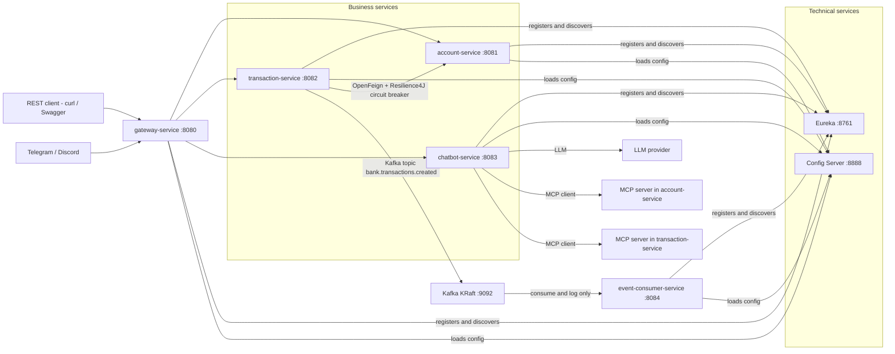
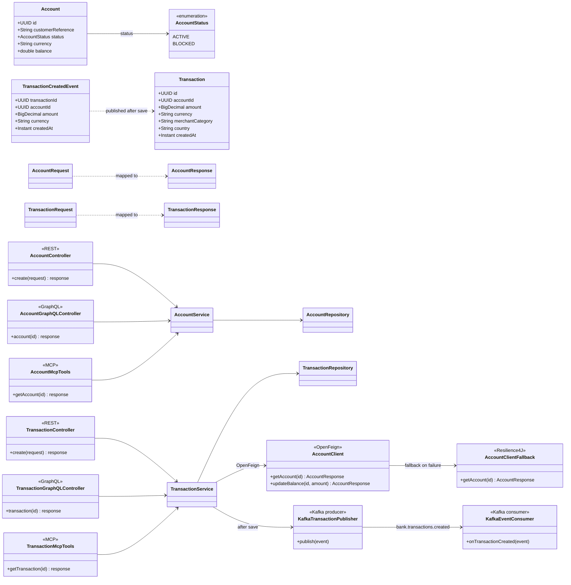
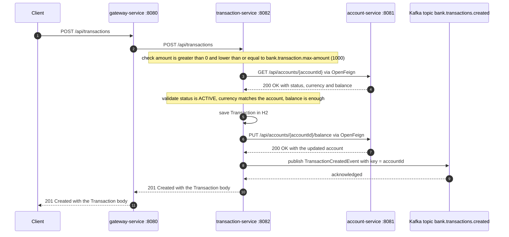

# Technical Exam – Microservices Architecture, AI and Full-Stack Development (ADRIA / ENSET)
**Author:** Mostapha Bayi
**Date:** October 30, 2026

## 1. Overview and architecture

### Modules and ports

| Module | Port | Role |
| --- | --- | --- |
| config-service | 8888 | Spring Cloud Config Server, native profile, files in `classpath:/config-repo` |
| discovery-service | 8761 | Eureka server, service registry |
| gateway-service | 8080 | Spring Cloud Gateway, `lb://` routes and discovery locator |
| account-service | 8081 | Business microservice 1 |
| transaction-service | 8082 | Business microservice 2 |
| chatbot-service | 8083 | Spring AI agent and MCP client |
| event-consumer-service | 8084 | Kafka consumer, logs only |
| Kafka (KRaft) | 9092 | Event streaming |
| Angular frontend | 4200 | Web client |

Start order: config, discovery, account, transaction, gateway, chatbot, consumer.

## 2. Prerequisites and how to run

## 3. Part B Design (diagrams)

### System architecture



### Class diagram



### Transaction creation sequence



## 4. Part C Account-Service

## 5. Part C Transaction-Service, OpenFeign and Resilience4J

## 6. Part D Technical services (Gateway, Eureka, Config)

### What was implemented

**discovery-service (8761) - Eureka server**

- Dependency `spring-cloud-starter-netflix-eureka-server` and `@EnableEurekaServer` on `DiscoveryServiceApplication`.
- `eureka.client.register-with-eureka: false` and `eureka.client.fetch-registry: false`: it is a standalone registry, it must not register with itself.
- It is also a config client: `spring.config.import=optional:configserver:http://localhost:8888`.

**config-service (8888) - Spring Cloud Config Server**

- Dependency `spring-cloud-config-server` and `@EnableConfigServer` on `ConfigServiceApplication`.
- Profile `native` with `spring.cloud.config.server.native.search-locations=classpath:/config-repo`, so configuration is read from the classpath and not from a Git repository.
- `config-service/src/main/resources/config-repo/application.yml` is served to every service as the shared `application` profile:

```yaml
bank:
  transaction:
    max-amount: 1000
eureka:
  client:
    service-url:
      defaultZone: http://localhost:8761/eureka
management:
  endpoints:
    web:
      exposure:
        include: health,info,metrics,prometheus,refresh,circuitbreakers,circuitbreakerevents
```

- It registers in Eureka as `CONFIG-SERVICE`, so a running Eureka is required first.

**gateway-service (8080) - Spring Cloud Gateway (reactive, Netty)**

| Route id | Path predicate | Target |
| --- | --- | --- |
| `account-service-routes` | `/api/accounts/**`, `/api/transfers/**`, `/graphql/accounts` | `lb://account-service` |
| `transaction-service-routes` | `/api/transactions/**`, `/graphql/transactions` | `lb://transaction-service` |
| `chatbot-service-routes` | `/api/chat/**` | `lb://chatbot-service` |

- The discovery locator is enabled with `lower-case-service-id: true`, so a service is also reachable through `/{serviceId}/**`, for example `/config-service/actuator/health`.
- A `LoggingGlobalFilter` (`-1` order) logs every call with its method, path, status, duration and reactive signal (`onComplete` / `onError`). It uses `doFinally`, because a call with no available instance completes with an error signal and would be missed by `then(...)`.
- Technical choices in this Spring Cloud train (2025.0.0): the starter `spring-cloud-starter-gateway` is deprecated, so `spring-cloud-starter-gateway-server-webflux` is used instead, and the gateway properties live under `spring.cloud.gateway.server.webflux.*`. Both choices remove the deprecation and property-rename warnings that were observed at startup.
- Every service sets `spring.application.name` to its module name and imports `optional:configserver:http://localhost:8888`.

### Run commands

Start order: config, discovery, gateway (then the business services).

```bash
.\mvnw.cmd clean package -DskipTests
java -jar config-service/target/config-service-1.0.0.jar
java -jar discovery-service/target/discovery-service-1.0.0.jar
java -jar gateway-service/target/gateway-service-1.0.0.jar
```

### Verification

```bash
curl http://localhost:8761/                       # Eureka dashboard, HTTP 200, <title>Eureka</title>
curl http://localhost:8888/actuator/health        # {"status":"UP"}
curl http://localhost:8888/application/default    # serves bank.transaction.max-amount: 1000
curl http://localhost:8761/eureka/apps            # lists CONFIG-SERVICE and GATEWAY-SERVICE
curl -i http://localhost:8080/api/accounts/123    # 503: route matched, no account-service instance yet
curl -i http://localhost:8080/config-service/actuator/health   # 200 through the discovery locator
```

Expected body of `GET http://localhost:8888/application/default`:

```json
{"name":"application","profiles":["default"],"propertySources":[{"name":"classpath:/config-repo/application.yml","source":{"bank.transaction.max-amount":1000,"eureka.client.service-url.defaultZone":"http://localhost:8761/eureka","management.endpoints.web.exposure.include":"health,info,metrics,prometheus,refresh,circuitbreakers,circuitbreakerevents"}}]}
```


*Screenshot to add*


*Screenshot to add*


*Screenshot to add*

## 7. Part E Agentic chatbot

## 8. Part F Kafka

## 9. Limitations and possible improvements
