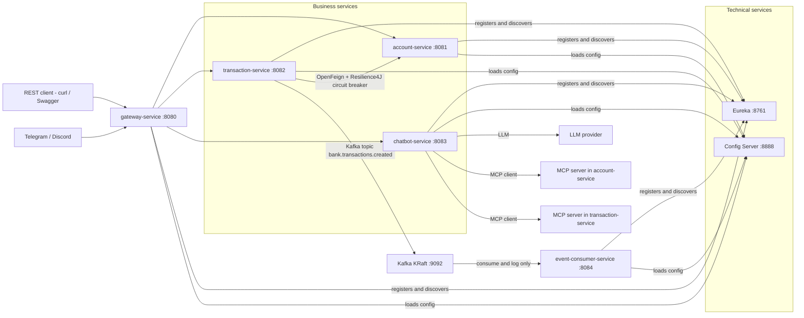
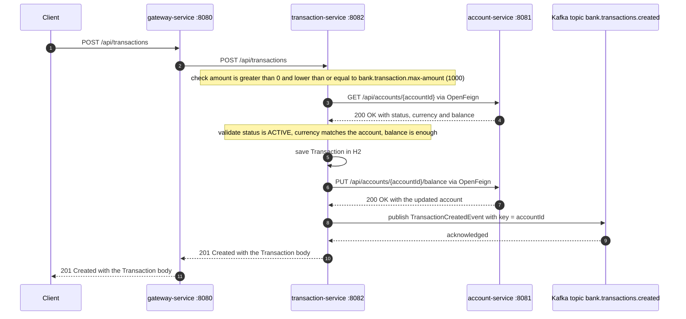

# Technical Exam – Microservices Architecture, AI and Full-Stack Development (ADRIA / ENSET)
**Author:** Mostapha Bayi
**Date:** October 30, 2026

## 1. Overview and architecture

### Modules and ports

| Module | Port | Role |
| --- | --- | --- |
| config-service | 8888 | Spring Cloud Config Server, native profile, files in `classpath:/config-repo` |
| discovery-service | 8761 | Eureka server, service registry |
| gateway-service | 8080 | Spring Cloud Gateway, `lb://` routes and discovery locator |
| account-service | 8081 | Business microservice 1 |
| transaction-service | 8082 | Business microservice 2 |
| chatbot-service | 8083 | Spring AI agent and MCP client |
| event-consumer-service | 8084 | Kafka consumer, logs only |
| Kafka (KRaft) | 9092 | Event streaming |
| Angular frontend | 4200 | Web client |

Start order: config, discovery, account, transaction, gateway, chatbot, consumer.

## 2. Prerequisites and how to run

## 3. Part B Design (diagrams)

### System architecture



### Class diagram


### Transaction creation sequence



## 4. Part C Account-Service

### What was implemented

All code lives under `com.bank.accountservice` and follows the mandatory layering:

| Layer | Package | Contents |
| --- | --- | --- |
| Domain | `domain/` | `Account`, `AccountStatus`, `AccountNotFoundException`, `InsufficientFundsException`, `InvalidOperationException` |
| Repository | `repository/` | `AccountRepository extends JpaRepository<Account,UUID>` plus `findByCustomerReference` |
| Service | `service/` | `AccountService` (all business validation) and the `TransferResult` record |
| REST | `web/rest/` | `AccountController`, `TransferController`, request/response DTOs, `GlobalExceptionHandler` |

`AccountService` exposes `create`, `findById`, `findAll`, `findByCustomerReference`, `updateStatus`,
`getBalance`, `debit`, `credit` and `transfer`. `transfer` is `@Transactional` and moves the amount
atomically: both accounts must exist, be `ACTIVE`, share the same currency, hold enough funds and
be two different accounts. The controllers only map HTTP to service calls: no rule lives there.

### Seed data

`SeedData` (a `CommandLineRunner`) fills the in-memory H2 database and prints the UUIDs:

| Customer | Status | Currency | Balance |
| --- | --- | --- | --- |
| CUST-001 | ACTIVE | EUR | 5000 |
| CUST-002 | ACTIVE | EUR | 3000 |
| CUST-003 | BLOCKED | EUR | 1500 |

### Technical choices

- **H2 in memory** (`jdbc:h2:mem:accountdb`) with `ddl-auto: update`, so the schema is rebuilt at
  every start and the seed data runs again.
- **Lombok** on the entity (`@Getter`, `@Setter`, `@Builder`), **records** for the DTOs so that
  Bean Validation annotations bind to the constructor parameters.
- **`maven-compiler-plugin` now sets `<parameters>true</parameters>`** in the parent POM. Without
  it every `@PathVariable UUID id` returned `400` with *"Name for argument of type [java.util.UUID]
  not specified"*, because Spring needs the parameter names and the default build does not keep them.
- **Errors**: one `@RestControllerAdvice` returns `{timestamp,status,error,message}` with
  `404` unknown account, `400` Bean Validation or malformed input, `409` broken business rule.
- account-service registers in Eureka and imports the config server like every other service.

### Run commands

```bash
.\mvnw.cmd clean package
java -jar config-service/target/config-service-1.0.0.jar
java -jar discovery-service/target/discovery-service-1.0.0.jar
java -jar account-service/target/account-service-1.0.0.jar
```

Run only the tests of this module:

```bash
.\mvnw.cmd -pl account-service test
```

### Curl examples (one per endpoint)

Replace `$ID` with an UUID printed in the log at start, for example `CUST-001`.

```bash
# 1. Create an account -> 201
curl -i -X POST http://localhost:8081/api/accounts -H 'Content-Type: application/json' \
  -d '{"customerReference":"CUST-004","currency":"EUR","balance":750}'
# {"id":"...","customerReference":"CUST-004","status":"ACTIVE","currency":"EUR","balance":750.0}

# 2. List all accounts -> 200
curl http://localhost:8081/api/accounts
# [{"id":"...","customerReference":"CUST-001","status":"ACTIVE","currency":"EUR","balance":5000.0}, ...]

# 3. Get one account -> 200, or 404 when the id does not exist
curl http://localhost:8081/api/accounts/$ID

# 4. Get the balance -> 200
curl http://localhost:8081/api/accounts/$ID/balance
# {"balance":5000.0}

# 5. Change the status -> 200
curl -X PATCH http://localhost:8081/api/accounts/$ID/status \
  -H 'Content-Type: application/json' -d '{"status":"BLOCKED"}'

# 6. Debit -> 200, 409 when the funds are not enough or the account is BLOCKED
curl -X POST http://localhost:8081/api/accounts/$ID/debit \
  -H 'Content-Type: application/json' -d '{"amount":500}'

# 7. Credit -> 200
curl -X POST http://localhost:8081/api/accounts/$ID/credit \
  -H 'Content-Type: application/json' -d '{"amount":500}'

# 8. Transfer -> 201, 409 on insufficient funds, blocked account or currency mismatch
curl -i -X POST http://localhost:8081/api/transfers -H 'Content-Type: application/json' \
  -d "{\"fromAccountId\":\"$FROM\",\"toAccountId\":\"$TO\",\"amount\":1000}"
# {"fromAccountId":"...","toAccountId":"...","amount":1000.0,"currency":"EUR","fromBalance":4000.0,"toBalance":4000.0}
```

Error bodies actually observed:

```json
{"timestamp":"2026-10-30T10:54:09Z","status":404,"error":"Not Found","message":"Account not found: 00000000-0000-0000-0000-000000000000"}
{"timestamp":"2026-10-30T10:53:38Z","status":400,"error":"Bad Request","message":"amount must be greater than 0"}
{"timestamp":"2026-10-30T10:53:39Z","status":409,"error":"Conflict","message":"Insufficient funds on account ...: balance is 4000.0 but 999999.0 was requested"}
```

### GraphQL

The same service layer is also exposed over GraphQL with `spring-boot-starter-graphql`.
Two controllers live in `web/graphql/` and call **only** `AccountService`: `AccountQueryController`
(`@QueryMapping`) and `AccountMutationController` (`@MutationMapping`, `@Argument`).

| Setting | Value |
| --- | --- |
| Endpoint | `http://localhost:8081/graphql/accounts` (`spring.graphql.path`) |
| GraphiQL | `http://localhost:8081/graphiql` (enabled, redirects with `?path=/graphql/accounts`) |
| Schema | `src/main/resources/graphql/schema.graphqls` |

Schema summary: `enum AccountStatus`, `type Account`, `input AccountCreateInput`, `input TransferInput`,
`type TransferResult`, `Query { accounts, accountById(id), accountsByCustomer(customerReference) }`,
`Mutation { createAccount(input), updateAccountStatus(id, status), transfer(input) }`.

**Sample query to paste into GraphiQL** (open `http://localhost:8081/graphiql`, the endpoint is preselected):

```graphql
query AccountsOverview {
  accounts {
    id
    customerReference
    status
    currency
    balance
  }
  accountById(id: "PASTE-A-SEED-UUID") {
    id
    status
    balance
  }
  accountsByCustomer(customerReference: "CUST-002") {
    id
    customerReference
    balance
  }
}
```

**Sample mutation to paste into GraphiQL:**

```graphql
mutation MoveMoney {
  transfer(input: {
    fromAccountId: "PASTE-ACTIVE-UUID-1"
    toAccountId: "PASTE-ACTIVE-UUID-2"
    amount: 250
  }) {
    fromAccountId
    toAccountId
    amount
    currency
    fromBalance
    toBalance
  }
}
```

The two other mutations:

```graphql
mutation CreateAccount {
  createAccount(input: { customerReference: "CUST-100", currency: "EUR", balance: 42.5, status: ACTIVE }) {
    id
    customerReference
    status
    currency
    balance
  }
}

mutation BlockAccount {
  updateAccountStatus(id: "PASTE-A-SEED-UUID", status: BLOCKED) {
    id
    status
  }
}
```

Same thing from the command line:

```bash
curl -X POST http://localhost:8081/graphql/accounts -H 'Content-Type: application/json' \
  -d '{"query":"{ accounts { id customerReference status currency balance } }"}'
# {"data":{"accounts":[{"id":"...","customerReference":"CUST-001","status":"ACTIVE","currency":"EUR","balance":5000.0}, ...]}}
```

Verified live: all three queries, all three mutations, `accountById` returning `null` for an unknown id,
and business failures returned as `"errors":[...]` with `"data":null` (the detailed message, for example
*"Account ... is BLOCKED and cannot be used for this operation"*, is written to the service log).
GraphQL validation mistakes are reported as `ValidationError`, for example requesting an unknown field.


*Screenshot to add*

### MCP server

The account-service also publishes its service layer as an MCP server so the agentic chatbot can
call it. Dependency `spring-ai-starter-mcp-server-webmvc`, tools in `mcp/AccountMcpTools`.
Every `@Tool` method only delegates to `AccountService`, so REST, GraphQL and MCP share the exact
same validation. The tools are published by the `ToolCallbackProvider` bean built with
`MethodToolCallbackProvider.builder().toolObjects(...)` in `mcp/AccountMcpConfiguration`; the
auto-configuration picks up any `ToolCallbackProvider` bean and registers its callbacks (the log
confirms it: `McpServerAutoConfiguration - Registered tools: 6`).

| Tool | Parameters | Returns |
| --- | --- | --- |
| `listAccounts` | - | list of accounts |
| `getAccount` | `id` | account |
| `getBalance` | `id` | balance |
| `createAccount` | `customerReference`, `currency`, `balance`, `status` (optional) | account |
| `updateAccountStatus` | `id`, `status` | account |
| `transferFunds` | `fromAccountId`, `toAccountId`, `amount` | transfer result |

Configuration (`application.yml`):

```yaml
spring:
  ai:
    mcp:
      server:
        name: account-mcp-server
        version: 1.0.0
        type: SYNC
        sse-endpoint: /sse
        sse-message-endpoint: /mcp/message
```

**Exact URLs used by Spring AI 1.0.3**: the SSE stream is `GET http://localhost:8081/sse` and the
client posts JSON-RPC to `POST http://localhost:8081/mcp/message?sessionId=<uuid>` on the same port
8081. Selecting SSE is done by adding the `webmvc` starter: **there is no `spring.ai.mcp.server.protocol`
property in 1.0.x** (it only exists from 1.1 onwards), so setting it would be silently ignored.
`/sse` and `/mcp/message` are the defaults, they are written out above to make them explicit.

**How to verify**

```bash
# 1. Open the stream, it stays open and answers immediately
curl -N http://localhost:8081/sse
# id:5b32cc6d-bc3c-451d-8ba4-6c5bfea5e7a9
# event:endpoint
# data:/mcp/message?sessionId=5b32cc6d-bc3c-451d-8ba4-6c5bfea5e7a9

# 2. Use the sessionId from that event
SID=5b32cc6d-bc3c-451d-8ba4-6c5bfea5e7a9
U="http://localhost:8081/mcp/message?sessionId=$SID"

# 3. Initialise the session
curl -X POST "$U" -H 'Content-Type: application/json' -d '{
  "jsonrpc":"2.0","id":1,"method":"initialize","params":{
    "protocolVersion":"2025-03-26","capabilities":{},
    "clientInfo":{"name":"curl-client","version":"1.0"}}}'
curl -X POST "$U" -H 'Content-Type: application/json' \
  -d '{"jsonrpc":"2.0","method":"notifications/initialized"}'

# 4. List the six tools
curl -X POST "$U" -H 'Content-Type: application/json' \
  -d '{"jsonrpc":"2.0","id":2,"method":"tools/list"}'

# 5. Call one
curl -X POST "$U" -H 'Content-Type: application/json' -d '{
  "jsonrpc":"2.0","id":3,"method":"tools/call","params":{
    "name":"getBalance","arguments":{"id":"PASTE-A-SEED-UUID"}}}'
```

The POST only acknowledges with `200`; the JSON-RPC results arrive back **on the `/sse` stream** as
`event: message`. Observed results:

- `initialize` → `serverInfo {"name":"account-mcp-server","version":"1.0.0"}`
- `tools/list` → the six tools with their `inputSchema` (parameter names come from the Java method
  thanks to the `-parameters` compiler flag, descriptions from `@ToolParam`)
- `tools/call getBalance` → `{"content":[{"type":"text","text":"5000.0"}],"isError":false}`
- `tools/call transferFunds` (250 from 5000 to 3000) → `fromBalance 4750.0`, `toBalance 3250.0`
- `tools/call transferFunds` from a BLOCKED account → `isError:true` with the message *"Account ...
  is BLOCKED and cannot be used for this operation"*, the very message the service produces

REST, GraphQL and GraphiQL keep answering `200` while the MCP server runs: they share the same port.


*Screenshot to add*

### Tests

`AccountServiceTest` (JUnit 5 + Mockito, repository mocked): transfer between two ACTIVE accounts,
transfer rejected for insufficient funds, transfer rejected on a BLOCKED account.

```text
Tests run: 3, Failures: 0, Errors: 0, Skipped: 0
```


*Screenshot to add*


*Screenshot to add*


*Screenshot to add*

## 5. Part C Transaction-Service, OpenFeign and Resilience4J

### What was implemented

All code lives under `com.bank.transactionservice` and follows the mandatory layering:

| Layer | Package | Contents |
| --- | --- | --- |
| Domain | `domain/` | `Transaction`, `TransactionLimitExceededException`, `AccountNotActiveException`, `CurrencyMismatchException`, `InsufficientBalanceException`, `AccountServiceUnavailableException`, `AccountNotFoundException`, `TransactionNotFoundException` |
| Repository | `repository/` | `TransactionRepository extends JpaRepository<Transaction,UUID>` plus `findByAccountIdOrderByCreatedAtDesc` |
| Service | `service/` | `TransactionService`, `TransactionLimitHolder`, `AccountGateway` + `RestClientAccountGateway`, `TransactionEventPublisher` + `NoOpTransactionEventPublisher`, `AccountSnapshot`, `TransactionSummary` |
| REST | `web/rest/` | `TransactionController`, request/response DTOs, `GlobalExceptionHandler` |

`Transaction` keeps exactly the specified fields; `amount` is `BigDecimal(19,2)`, `createdAt` is an
`Instant` filled by `@PrePersist`, and the table is named `transactions` because `TRANSACTION` is a
reserved SQL word.

**Order of the rules in `TransactionService.create`, exactly as specified:**

1. `amount > 0`
2. `amount <= bank.transaction.max-amount`
3. read the account
4. account must be `ACTIVE`
5. currencies must match
6. balance must be enough
7. `save` (`@Transactional`)
8. debit the account
9. publish the event through `TransactionEventPublisher`

### Technical choices

- **`AccountGateway` is an interface**, implemented today by `RestClientAccountGateway` with a
  `@LoadBalanced RestClient.Builder` and the Eureka service id `http://account-service`. Spring
  Cloud's `LoadBalancerRestClientBuilderBeanPostProcessor` resolves it to a real instance, so the
  next step can swap in Feign by changing only the implementation.
- The builder bean is declared in `RestClientConfiguration`: Boot exposes no load-balanced builder
  by itself, and `@LoadBalanced` acts as a qualifier, so injecting one without declaring it fails
  with *"No qualifying bean of type RestClient$Builder"*.
- **`bank.transaction.max-amount`** is injected with `@Value` in `TransactionLimitHolder`, a bean
  annotated `@RefreshScope`, so the value published by config-service can change at runtime.
- **`TransactionEventPublisher`** is an interface with a no-op implementation that only logs;
  Kafka is wired in the next step.
- Errors: `400` validation or malformed body, `404` unknown transaction or unknown account,
  `409` broken business rule, `503` account-service unreachable, `404/405/415` for wrong path,
  method or content type, `500` for the unexpected.

### Endpoints

| Method | Path | Purpose |
| --- | --- | --- |
| POST | `/api/transactions` | create a transaction |
| GET | `/api/transactions` | list all |
| GET | `/api/transactions/{id}` | one transaction |
| GET | `/api/transactions/account/{accountId}` | transactions of an account, newest first |

`TransactionService.summary(accountId)` (count and total amount) is implemented but not exposed
over HTTP yet.

### Run commands

```bash
.\mvnw.cmd clean package
java -jar config-service/target/config-service-1.0.0.jar        # first, it serves the limit
java -jar discovery-service/target/discovery-service-1.0.0.jar
java -jar account-service/target/account-service-1.0.0.jar
java -jar transaction-service/target/transaction-service-1.0.0.jar
.\mvnw.cmd -pl transaction-service test
```

### Curl tests

```bash
ID=<account UUID printed by account-service at start>

# A normal transaction debits the account
curl http://localhost:8081/api/accounts/$ID/balance
# {"balance":5000.0}

curl -i -X POST http://localhost:8082/api/transactions -H 'Content-Type: application/json' \
  -d "{\"accountId\":\"$ID\",\"amount\":250.00,\"currency\":\"EUR\",\"merchantCategory\":\"GROCERIES\",\"country\":\"FR\"}"
# HTTP 201
# {"id":"43ba0971-...","accountId":"4c6c9ae0-...","amount":250.00,"currency":"EUR",
#  "merchantCategory":"GROCERIES","country":"FR","createdAt":"2026-10-30T12:02:42.421957900Z"}

curl http://localhost:8081/api/accounts/$ID/balance
# {"balance":4750.0}          <- debited through the load balanced RestClient

# An amount of 1500 is rejected
curl -i -X POST http://localhost:8082/api/transactions -H 'Content-Type: application/json' \
  -d "{\"accountId\":\"$ID\",\"amount\":1500.00,\"currency\":\"EUR\",\"merchantCategory\":\"TRAVEL\",\"country\":\"FR\"}"
# HTTP 409
# {"timestamp":"2026-10-30T12:02:44Z","status":409,"error":"Conflict",
#  "message":"Transaction amount 1500.00 exceeds the limit of 1000.0"}

# The rejected transaction did not move any money
# {"balance":4750.0}
```

Other responses actually observed:

```json
{"timestamp":"...","status":400,"error":"Bad Request","message":"accountId must not be null"}
{"timestamp":"...","status":400,"error":"Bad Request","message":"amount must be greater than 0"}
{"timestamp":"...","status":404,"error":"Not Found","message":"Transaction not found: 00000000-0000-0000-0000-000000000000"}
{"timestamp":"...","status":409,"error":"Conflict","message":"Currency mismatch: account ... is in EUR but the transaction is in USD"}
{"timestamp":"...","status":409,"error":"Conflict","message":"Account ... is BLOCKED and cannot receive transactions"}
{"timestamp":"...","status":503,"error":"Service Unavailable","message":"account-service is not reachable: ... Connection refused"}
```

### Tests

`TransactionServiceTest` (JUnit 5 + Mockito, every collaborator mocked): amount over 1000 rejected,
blocked account, currency mismatch, insufficient funds, plus one success case asserting the debit
and the event publication.

```text
Tests run: 5, Failures: 0, Errors: 0, Skipped: 0
```


*Screenshot to add*


*Screenshot to add*

OpenFeign and Resilience4J are covered in the next step of Part C.

## 6. Part D Technical services (Gateway, Eureka, Config)

### What was implemented

**discovery-service (8761) - Eureka server**

- Dependency `spring-cloud-starter-netflix-eureka-server` and `@EnableEurekaServer` on `DiscoveryServiceApplication`.
- `eureka.client.register-with-eureka: false` and `eureka.client.fetch-registry: false`: it is a standalone registry, it must not register with itself.
- It is also a config client: `spring.config.import=optional:configserver:http://localhost:8888`.

**config-service (8888) - Spring Cloud Config Server**

- Dependency `spring-cloud-config-server` and `@EnableConfigServer` on `ConfigServiceApplication`.
- Profile `native` with `spring.cloud.config.server.native.search-locations=classpath:/config-repo`, so configuration is read from the classpath and not from a Git repository.
- `config-service/src/main/resources/config-repo/application.yml` is served to every service as the shared `application` profile:

```yaml
bank:
  transaction:
    max-amount: 1000
eureka:
  client:
    service-url:
      defaultZone: http://localhost:8761/eureka
management:
  endpoints:
    web:
      exposure:
        include: health,info,metrics,prometheus,refresh,circuitbreakers,circuitbreakerevents
```

- It registers in Eureka as `CONFIG-SERVICE`, so a running Eureka is required first.

**gateway-service (8080) - Spring Cloud Gateway (reactive, Netty)**

| Route id | Path predicate | Target |
| --- | --- | --- |
| `account-service-routes` | `/api/accounts/**`, `/api/transfers/**`, `/graphql/accounts` | `lb://account-service` |
| `transaction-service-routes` | `/api/transactions/**`, `/graphql/transactions` | `lb://transaction-service` |
| `chatbot-service-routes` | `/api/chat/**` | `lb://chatbot-service` |

- The discovery locator is enabled with `lower-case-service-id: true`, so a service is also reachable through `/{serviceId}/**`, for example `/config-service/actuator/health`.
- A `LoggingGlobalFilter` (`-1` order) logs every call with its method, path, status, duration and reactive signal (`onComplete` / `onError`). It uses `doFinally`, because a call with no available instance completes with an error signal and would be missed by `then(...)`.
- Technical choices in this Spring Cloud train (2025.0.0): the starter `spring-cloud-starter-gateway` is deprecated, so `spring-cloud-starter-gateway-server-webflux` is used instead, and the gateway properties live under `spring.cloud.gateway.server.webflux.*`. Both choices remove the deprecation and property-rename warnings that were observed at startup.
- Every service sets `spring.application.name` to its module name and imports `optional:configserver:http://localhost:8888`.

### Run commands

Start order: config, discovery, gateway (then the business services).

```bash
.\mvnw.cmd clean package -DskipTests
java -jar config-service/target/config-service-1.0.0.jar
java -jar discovery-service/target/discovery-service-1.0.0.jar
java -jar gateway-service/target/gateway-service-1.0.0.jar
```

### Verification

```bash
curl http://localhost:8761/                       # Eureka dashboard, HTTP 200, <title>Eureka</title>
curl http://localhost:8888/actuator/health        # {"status":"UP"}
curl http://localhost:8888/application/default    # serves bank.transaction.max-amount: 1000
curl http://localhost:8761/eureka/apps            # lists CONFIG-SERVICE and GATEWAY-SERVICE
curl -i http://localhost:8080/api/accounts/123    # 503: route matched, no account-service instance yet
curl -i http://localhost:8080/config-service/actuator/health   # 200 through the discovery locator
```

Expected body of `GET http://localhost:8888/application/default`:

```json
{"name":"application","profiles":["default"],"propertySources":[{"name":"classpath:/config-repo/application.yml","source":{"bank.transaction.max-amount":1000,"eureka.client.service-url.defaultZone":"http://localhost:8761/eureka","management.endpoints.web.exposure.include":"health,info,metrics,prometheus,refresh,circuitbreakers,circuitbreakerevents"}}]}
```


*Screenshot to add*


*Screenshot to add*


*Screenshot to add*

## 7. Part E Agentic chatbot

## 8. Part F Kafka

## 9. Limitations and possible improvements
