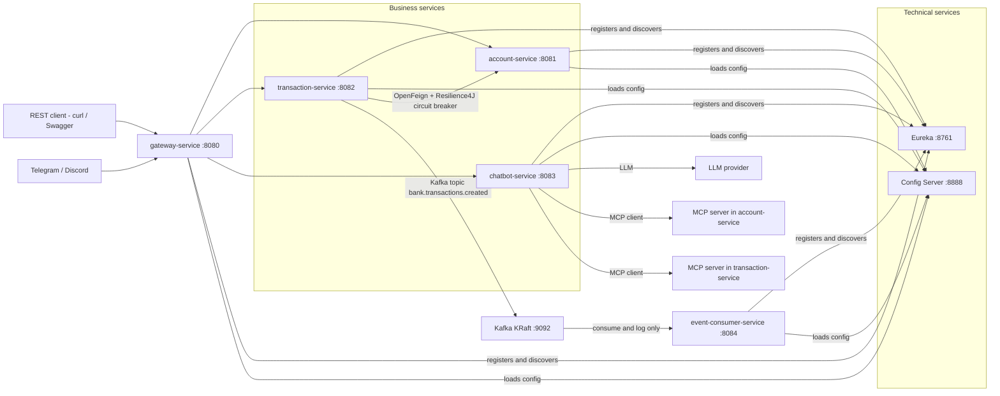
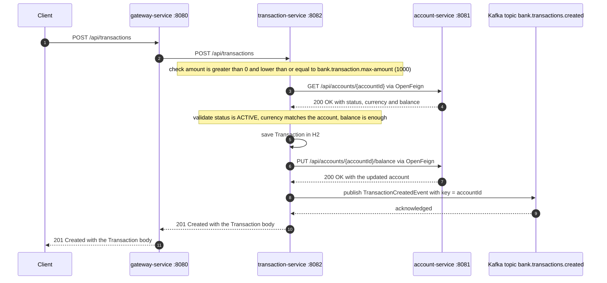

# Technical Exam – Microservices Architecture, AI and Full-Stack Development (ADRIA / ENSET)
**Author:** Mostapha Bayi
**Date:** October 30, 2026

## 1. Overview and architecture

### Modules and ports

| Module | Port | Role |
| --- | --- | --- |
| config-service | 8888 | Spring Cloud Config Server, native profile, files in `classpath:/config-repo` |
| discovery-service | 8761 | Eureka server, service registry |
| gateway-service | 8080 | Spring Cloud Gateway, `lb://` routes and discovery locator |
| account-service | 8081 | Business microservice 1 |
| transaction-service | 8082 | Business microservice 2 |
| chatbot-service | 8083 | Spring AI agent and MCP client |
| event-consumer-service | 8084 | Kafka consumer, logs only |
| Kafka (KRaft) | 9092 | Event streaming |
| Angular frontend | 4200 | Web client |

Start order: config, discovery, account, transaction, gateway, chatbot, consumer.

## 2. Prerequisites and how to run

## 3. Part B Design (diagrams)

### System architecture

### Class diagram

### Transaction creation sequence

## 4. Part C Account-Service

## 5. Part C Transaction-Service, OpenFeign and Resilience4J

## 6. Part D Technical services (Gateway, Eureka, Config)

## 7. Part E Agentic chatbot

## 8. Part F Kafka

## 9. Limitations and possible improvements
